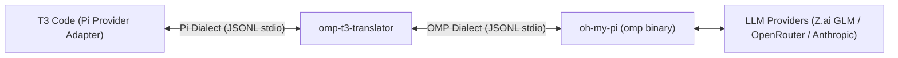

# Technical Specification: OMP-to-T3 Code Translator Shim (`omp-t3-translator`)

## 1. Executive Summary

The **OMP-to-T3 Code Translator** is an out-of-process, zero-modification stdio RPC proxy. It sits between **T3 Code**'s first-class Pi provider (`packages/provider-pi/src/server/adapter.ts`) and **Oh My Pi** (`omp` binary, v18.x+). 

### The Problem
When pointing T3 Code's Pi provider to the `omp` binary directly, turns fail or hang indefinitely:
1. **Turn Settlement Mismatch ([T3 Code #19490](https://github.com/pingdotgg/t3code/issues/19490)):** `omp` emits `session_settled` (preceded by `prompt_result`), whereas T3 Code's Pi adapter treats **only** upstream Pi's `agent_settled` frame as terminal. T3 maintainers closed #19490 as `wontfix` / "unsupported swap".
2. **Permission & Extension-UI Suppression:** T3 spawns processes strictly with `--mode rpc`. In `omp`, plain `rpc` mode silences extension UI / approval requests; dialog frames are gated behind `rpc-ui` mode. Consequently, T3's Supervised / Auto permission gates never receive tool approval prompts.
3. **Transport Frame Limit Overflow:** `omp` supports 60+ providers with hundreds of models. When T3 queries `get_available_models`, `omp`'s unpaginated response exceeds its internal 1MB frame limit (`maxFrameBytes: 1048576`), triggering `"RPC response exceeded the transport limit"` and breaking model discovery.

### The Solution: Zero-Fork Architecture
Rather than maintaining brittle forks of T3 Code or `omp`, the **Translator Shim** acts as a lightweight proxy:
- Configured in T3 Code as the Pi provider's `binaryPath` (e.g. `/usr/local/bin/omp-t3-translator`).
- Accepts T3's CLI arguments, rewrites `--mode rpc` to `--mode rpc-ui`, and spawns the real `omp` binary.
- Translates JSON-RPC / JSONL messages bidirectionally in real time over stdio.
- Synthesizes `agent_settled` from `session_settled`, preserves approval flows, and handles model catalog truncation safely.



---

## 2. Process Lifecycle & CLI Argument Rewriting

When T3 Code starts a turn or initializes a thread, it spawns `binaryPath` with standard arguments:
```bash
<binaryPath> --mode rpc [--session <sessionId>] [--fork <sessionId>] [--hide-thinking] ...
```

### 2.1 Argument Translation Rules
| Incoming T3 Argument | Outgoing OMP Argument | Rationale |
|---|---|---|
| `--mode rpc` | `--mode rpc-ui` | **Critical:** `rpc-ui` enables tool approval frames (`extension_ui_request`) which plain `rpc` suppresses in OMP. |
| `--session <id>` | `--session <id>` | Passthrough. OMP natively supports session resumption from disk. |
| `--fork <id>` | `--fork <id>` | Passthrough. OMP natively supports session branch/rollback. |
| `--hide-thinking` | `--hide-thinking` | Passthrough. Supported by OMP. |
| `--approval-mode <m>` | `--approval-mode <m>` | Passthrough (or mapped if T3 passes permission overrides). |
| Unknown / Bridge flags | Evaluated / Filtered | Strips any T3-specific extension flags that OMP's CLI parser would reject. |

---

## 3. Bidirectional Protocol Translation Matrix

### 3.1 Downstream (OMP $
ightarrow$ Translator $
ightarrow$ T3 Code)

| OMP Event Received | State Action | Frame Emitted to T3 Code | Notes |
|---|---|---|---|
| `{"type": "ready", ...}` | Cache protocol limits (`maxFrameBytes`) | `{"type": "ready", ...}` | Passthrough. |
| `{"type": "prompt_result", "status": s, "agentInvoked": a}` | Store `lastPromptStatus = s` | Suppressed (or converted to Pi response ack if pending) | Pi adapter does not consume OMP's `prompt_result` frame. |
| `{"type": "session_settled"}` | Read `lastPromptStatus` | `{"type": "agent_settled", "aborted": (s == "aborted")}` | **Solves #19490.** Emits terminal frame expected by T3 `PiAdapter`. |
| `{"type": "turn_start"}` | Update turn state | `{"type": "turn_start"}` | Passthrough. |
| `{"type": "turn_end", ...}` | Update turn state | `{"type": "turn_end", ...}` | Passthrough. |
| `{"type": "message_start", ...}` | None | `{"type": "message_start", ...}` | Passthrough. |
| `{"type": "message_update", ...}` | None | `{"type": "message_update", ...}` | Passthrough (text_delta, thinking_delta). |
| `{"type": "message_end", ...}` | None | `{"type": "message_end", ...}` | Passthrough. |
| `{"type": "extension_ui_request", ...}` | Forward dialog | `{"type": "extension_ui_request", ...}` | Delivers permission/approval modal requests to T3 UI. |
| `{"type": "advisor_cost_changed"}` | Ignored | Suppressed | OMP-internal feature; unhandled by T3. |
| `{"type": "available_commands_update"}` | None | `{"type": "available_commands_update", ...}` | Passthrough. |

### 3.2 Upstream (T3 Code $
ightarrow$ Translator $
ightarrow$ OMP)

| T3 Command Received | Translation / Handler Action | Frame Emitted to OMP |
|---|---|---|
| `{"type": "prompt", "message": ...}` | Reset `lastPromptStatus = null`; forward prompt | `{"type": "prompt", ...}` |
| `{"type": "abort"}` | Forward abort signal to OMP | `{"type": "abort"}` |
| `{"type": "get_available_models", "id": reqId}` | **Intercepted:** Filter model catalog or return cached active provider models | Synthesized `{"id": reqId, "type": "response", "command": "get_available_models", "success": true, "models": [...]}` (avoids >1MB overflow) |
| `{"type": "set_thinking_level", "level": ...}` | Passthrough | `{"type": "set_thinking_level", ...}` |
| `{"type": "compact"}` | Passthrough | `{"type": "compact"}` |
| `{"type": "extension_ui_response", ...}` | Passthrough user approval/denial | `{"type": "extension_ui_response", ...}` |

---

## 4. Deep-Dive: Critical Subsystems

### 4.1 Turn Settlement & Settle-Probe Harmony
In T3's `packages/provider-pi/src/server/adapter.ts`:
- When a user submits a prompt, T3 sets turn status to active.
- T3 arms an idle probe timer. If the probe fires while the agent is running, it reschedules.
- T3 only resolves the turn promise and persists output when it sees:
  ```typescript
  if (frame.type === 'agent_settled') {
    settleDeferred.resolve({ aborted: Boolean(frame.aborted) });
  }
  ```
- Because OMP only emits `session_settled`, T3 remains blocked.
- **Translator Rule:** When OMP emits `session_settled`, the translator intercepts it and transforms it into `{"type": "agent_settled", "aborted": lastPromptStatus === 'aborted'}`.

### 4.2 Safe Model Catalog Delivery
- In OMP v18.x, querying `get_available_models` attempts to serialize hundreds of models across all providers into one JSON string. Because `maxFrameBytes` is 1,048,576 bytes, OMP aborts with `"RPC response exceeded the transport limit"`.
- **Translator Rule:** The translator intercepts `get_available_models` requests:
  - It maintains a filtered cache containing only enabled/authenticated provider models (e.g. `zai` / GLM-5.3-flash, Claude 3.5, GPT-4o, DeepSeek).
  - Alternatively, it truncates descriptions and schema details so the JSON response size is well under 200KB.
  - This guarantees T3's model selector populates smoothly without error.

### 4.3 Extension UI & Approval Bridging
- T3 Code's permission hook relies on bidirectional extension dialogs (`extension_ui_request` / `extension_ui_response`).
- By running OMP in `--mode rpc-ui`, OMP emits these frames for:
  - File write confirmations outside workspace.
  - Bash command approvals.
  - Interactive questions.
- The translator forwards these frames cleanly between T3's client UI and OMP's tool harness.

---

## 5. Technical Implementation Blueprint

### 5.1 Architecture & Stack
- **Language:** Single-file Node.js (`omp-t3-translator.js`) or TypeScript compiled to standalone executable using Bun / Deno / Node SEA.
- **Dependencies:** Zero external dependencies (uses native `child_process`, `readline`, and `readline/promises`).
- **Overhead:** < 2MB memory footprint, < 0.5ms latency per frame.

### 5.2 Core State Machine
```text
                 +-------------------+
                 |    T3 Code        |
                 +-------------------+
                           |
                     (stdio spawn)
                           v
               +-----------------------+
               |  omp-t3-translator    |
               |                       |
               | - Arg rewriter        |
               | - Frame parser (JSONL)|
               | - Settlement filter   |
               | - Model-size limiter  |
               +-----------------------+
                           |
                     (child_process)
                           v
                 +-------------------+
                 |  omp --mode rpc-ui|
                 +-------------------+
```

### 5.3 Configuration in T3 Code
Users configure T3 Code to use the translator via GUI Settings or `~/.config/t3/config.json`:
```json
{
  "providers": {
    "pi": {
      "binaryPath": "/home/hash/.local/bin/omp-t3-translator",
      "customArgs": []
    }
  }
}
```

---

## 6. Verification & Test Plan

1. **Protocol Loopback Test:**
   - Scripted driver sends `prompt`, asserts receipt of streaming `text_delta`, `prompt_result`, and final translated `agent_settled`.
2. **Cancellation / Stop Test:**
   - Send prompt, immediately send `abort`, verify `agent_settled` emits with `aborted: true`.
3. **Model Listing Test:**
   - Send `get_available_models`, verify response is `success: true` and under 1MB.
4. **Interactive Approval Test:**
   - Trigger a bash tool call, verify `extension_ui_request` arrives in T3 Code UI and user confirmation passes back via `extension_ui_response`.
5. **End-to-End T3 Run:**
   - Run a real turn using GLM-5.3-flash on the user's Z.ai Coding Plan inside T3 Code UI.


---

## 5. Non-Interference & Safety Invariants (Preserving All Other Features)

Beyond the targeted divergences (settlement, dynamic models, subagents, and usage), T3 Code and OMP share over 95% identical RPC schemas (diff viewers, file editing, bash execution, thinking sliders, `/compact`, and branch rollback). 

To guarantee that `omp-t3` introduces **zero regressions**, the proxy strictly adheres to three safety invariants:

### 5.1 Invariant 1: Byte-Preserving Passthrough
Any line received from OMP stdout that does not match an explicit interceptor (`session_settled`, `subagent_event`, or synthetic responses) **MUST** be written directly to T3's `process.stdout` as raw bytes, without deserialization, mutation, or re-encoding.
```javascript
if (line.includes('"type":"message_update"') || line.includes('"type":"tool_execution_') || ...) {
  process.stdout.write(line + '
');
  return;
}
```

### 5.2 Invariant 2: Transparent CLI Flag Forwarding
When T3 Code executes `omp-t3 --mode rpc [flags...]`:
- Only `--mode rpc` is rewritten to `--mode rpc-ui`.
- All other arguments (`--session`, `--fork`, `--hide-thinking`, `--cwd`, etc.) are forwarded to the child `omp` process in their original position and ordering.
- If invoked without arguments, `omp-t3` defaults to spawning `omp --mode rpc-ui`.

### 5.3 Invariant 3: Signal & Exit Code Mirroring
- Signals (`SIGINT`, `SIGTERM`) received by `omp-t3` are immediately propagated to the child `omp` process group.
- When the child `omp` process terminates, `omp-t3` exits with the exact same exit code and stderr state.

---

## 6. Usage & Token Metric Tracking

### 6.1 The Two Usage Paths in T3 Code
T3 Code tracks token consumption and spend across two separate surfaces:
1. **Live Context Meter (In-Thread):** Displays input/output tokens used in the current conversation turn.
2. **Usage Dashboard (Global Analytics):** Displays historical spend, token aggregations, and session counts across all threads and providers (PR #17848).

### 6.2 Live Turn Usage Mapping
- In OMP v18.x, assistant messages and `turn_end` frames include rich token telemetry:
  ```json
  "usage": {
    "input": 7348,
    "output": 4,
    "cacheRead": 384,
    "cacheWrite": 0,
    "totalTokens": 7736,
    "cost": { "total": 0.000725 }
  }
  ```
- T3 Code's Pi adapter extracts `message.usage` from `message_end` / `turn_end` frames.
- **Translator Rule:** Because OMP uses the exact same field names (`input`, `output`, `cacheRead`, `cacheWrite`), live usage passes through automatically to T3's turn metrics.

### 6.3 Historical Dashboard Tracking (`PI_CODING_AGENT_DIR` Bridge)
- T3 Code's Usage Dashboard reads session transcripts stored under `~/.pi/agent/sessions`.
- OMP stores its sessions under `~/.omp/agent/sessions` by default.
- **Translator Rule:** When `omp-t3` spawns `omp`, it ensures session transcripts are accessible to T3's background usage scraper by either:
  1. Passing `PI_CODING_AGENT_DIR=~/.omp/agent` in the spawned environment (or syncing paths), or
  2. Setting up a directory symlink (`~/.pi/agent/sessions` $
ightarrow$ `~/.omp/agent/sessions`) during setup so T3's historical scraper indexes all OMP sessions without modifying server code.
