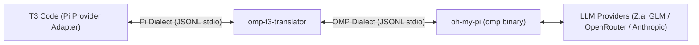

# Technical Specification: OMP-to-T3 Code Translator Shim (`omp-t3-translator`)

## 1. Executive Summary

The **OMP-to-T3 Code Translator** is an out-of-process, zero-modification stdio RPC proxy. It sits between **T3 Code**'s first-class Pi provider (`packages/provider-pi/src/server/adapter.ts`) and **Oh My Pi** (`omp` binary, v18.x+). 

### The Problem
When pointing T3 Code's Pi provider to the `omp` binary directly, turns fail or hang indefinitely:
1. **Turn Settlement Mismatch ([T3 Code #19490](https://github.com/pingdotgg/t3code/issues/19490)):** `omp` emits `session_settled` (preceded by `prompt_result`), whereas T3 Code's Pi adapter treats **only** upstream Pi's `agent_settled` frame as terminal. T3 maintainers closed #19490 as `wontfix` / "unsupported swap".
2. **Permission & Extension-UI Suppression:** T3 spawns processes strictly with `--mode rpc`. In `omp`, plain `rpc` mode silences extension UI / approval requests; dialog frames are gated behind `rpc-ui` mode. Consequently, T3's Supervised / Auto permission gates never receive tool approval prompts.
3. **Transport Frame Limit Overflow:** `omp` supports 60+ providers with hundreds of models. When T3 queries `get_available_models`, `omp`'s unpaginated response exceeds its internal 1MB frame limit (`maxFrameBytes: 1048576`), triggering `"RPC response exceeded the transport limit"` and breaking model discovery.
4. **Model Slug & ID Prefix Duplication:** T3 Code's Pi provider constructs model slugs as `${provider}/${id}`. If the model catalog returns `id` containing the provider prefix (e.g. `openrouter/deepseek/deepseek-v4.1-flash`), T3 Code constructs double-prefixed slugs (`openrouter/openrouter/...`), causing turn initiation via `set_model` to fail with `"Model not found"`.
5. **Command Discovery Query Missing:** T3 Code's provider initialization probes `get_commands`. If unhandled, initialization stalls or logs warnings.

### The Solution: Zero-Fork Architecture
Rather than maintaining brittle forks of T3 Code or `omp`, the **Translator Shim** acts as a lightweight proxy:
- Configured in T3 Code as the Pi provider's `binaryPath` (e.g. `/usr/local/bin/omp-t3` or `~/.local/bin/omp-t3`).
- Accepts T3's CLI arguments, rewrites `--mode rpc` to `--mode rpc-ui`, and spawns the real `omp` binary.
- Translates JSON-RPC / JSONL messages bidirectionally in real time over stdio.
- Synthesizes `agent_settled` from `session_settled`, preserves approval flows, and handles model catalog truncation safely.
- Strips redundant provider prefixes from model IDs in the catalog and defends against double-prefixed `set_model` frames from older thread states.
- Answers `get_commands` queries with a compliant empty command list.



---

## 2. Process Lifecycle & CLI Argument Rewriting

When T3 Code starts a turn or initializes a thread, it spawns `binaryPath` with standard arguments:
```bash
<binaryPath> --mode rpc [--session <sessionId>] [--fork <sessionId>] [--hide-thinking] ...
```

### 2.1 Argument Translation Rules
| Incoming T3 Argument | Outgoing OMP Argument | Rationale |
|---|---|---|
| `--mode rpc` | `--mode rpc-ui` | **Critical:** `rpc-ui` enables tool approval frames (`extension_ui_request`) which plain `rpc` suppresses in OMP. |
| (No arguments) | `--mode rpc-ui` | Defaults to zero-flag UX if spawned standalone or without explicit flags. |
| `--session <id>` | `--session <id>` | Passthrough. OMP natively supports session resumption from disk. |
| `--fork <id>` | `--fork <id>` | Passthrough. OMP natively supports session branch/rollback. |
| `--hide-thinking` | `--hide-thinking` | Passthrough. Supported by OMP. |
| `--approval-mode <m>` | `--approval-mode <m>` | Passthrough (or mapped if T3 passes permission overrides). |
| Unknown / Bridge flags | Evaluated / Filtered | Strips any T3-specific extension flags that OMP's CLI parser would reject. |

---

## 3. Bidirectional Protocol Translation Matrix

### 3.1 Downstream (OMP $\rightarrow$ Translator $\rightarrow$ T3 Code)

| OMP Event Received | State Action | Frame Emitted to T3 Code | Notes |
|---|---|---|---|
| `{"type": "ready", ...}` | Cache protocol limits (`maxFrameBytes`) | `{"type": "ready", ...}` | Passthrough. |
| `{"type": "prompt_result", "status": s, "agentInvoked": a}` | Store `lastPromptStatus = s` | Suppressed (or converted to Pi response ack if pending) | Pi adapter does not consume OMP's `prompt_result` frame. |
| `{"type": "session_settled"}` | Read `lastPromptStatus` | `{"type": "agent_settled", "aborted": (s == "aborted")}` | **Solves #19490.** Emits terminal frame expected by T3 `PiAdapter`. |
| `{"type": "turn_start"}` | Update turn state | `{"type": "turn_start"}` | Passthrough. |
| `{"type": "turn_end", ...}` | Update turn state | `{"type": "turn_end", ...}` | Passthrough (preserves live usage metrics). |
| `{"type": "message_start", ...}` | None | `{"type": "message_start", ...}` | Passthrough. |
| `{"type": "message_update", ...}` | None | `{"type": "message_update", ...}` | Passthrough (text_delta, thinking_delta). |
| `{"type": "message_end", ...}` | None | `{"type": "message_end", ...}` | Passthrough. |
| `{"type": "extension_ui_request", ...}` | Forward dialog | `{"type": "extension_ui_request", ...}` | Delivers permission/approval modal requests to T3 UI. |
| `{"type": "advisor_cost_changed"}` | Ignored | Suppressed | OMP-internal feature; unhandled by T3. |
| `{"type": "available_commands_update"}` | None | `{"type": "available_commands_update", ...}` | Passthrough. |
| `{"type": "task:subagent:event", ...}` | Normalize subagent card | `{"type": "subagent_event", ...}` | Normalizes subagent events. |

### 3.2 Upstream (T3 Code $\rightarrow$ Translator $\rightarrow$ OMP)

| T3 Command Received | Translation / Handler Action | Frame Emitted to OMP |
|---|---|---|
| `{"type": "prompt", "message": ...}` | Reset `lastPromptStatus = null`; forward prompt | `{"type": "prompt", ...}` |
| `{"type": "abort"}` | Forward abort signal to OMP | `{"type": "abort"}` |
| `{"type": "get_available_models", "id": reqId}` | **Intercepted:** Filter model catalog via `omp models --json` | Synthesized `{"id": reqId, "type": "response", "command": "get_available_models", "success": true, "data": {"models": [...]}, "models": [...]}` (avoids >1MB overflow; dual wrapper for T3 discovery) |
| `{"type": "get_commands", "id": reqId}` | **Intercepted:** Return empty command list | Synthesized `{"id": reqId, "type": "response", "command": "get_commands", "success": true, "data": {"commands": []}}` |
| `{"type": "set_model", "provider": p, "modelId": m}` | **Normalized:** Strips duplicate `${provider}/` prefix from `modelId` if present | Forwarded normalized `{"type": "set_model", "provider": p, "modelId": cleanModelId}` |
| `{"type": "set_thinking_level", "level": ...}` | Passthrough | `{"type": "set_thinking_level", ...}` |
| `{"type": "compact"}` | Passthrough | `{"type": "compact"}` |
| `{"type": "extension_ui_response", ...}` | Passthrough user approval/denial | `{"type": "extension_ui_response", ...}` |

---

## 4. Deep-Dive: Critical Subsystems

### 4.1 Turn Settlement & Settle-Probe Harmony
In T3's `packages/provider-pi/src/server/adapter.ts`:
- When a user submits a prompt, T3 sets turn status to active.
- T3 arms an idle probe timer. If the probe fires while the agent is running, it reschedules.
- T3 only resolves the turn promise and persists output when it sees:
  ```typescript
  if (frame.type === 'agent_settled') {
    settleDeferred.resolve({ aborted: Boolean(frame.aborted) });
  }
  ```
- Because OMP only emits `session_settled`, T3 remains blocked.
- **Translator Rule:** When OMP emits `session_settled`, the translator intercepts it and transforms it into `{"type": "agent_settled", "aborted": lastPromptStatus === 'aborted'}`.

### 4.2 Safe Model Catalog Delivery & Slug Compatibility
- In OMP v18.x, querying `get_available_models` attempts to serialize hundreds of models across all providers into one JSON string. Because `maxFrameBytes` is 1,048,576 bytes, OMP aborts with `"RPC response exceeded the transport limit"`.
- In T3 Code's provider adapter (`status.ts` and `adapter.ts`):
  - Slug is built as `const slug = `${provider}/${id}`;`.
  - When starting a turn, T3 splits on the first slash: `const [provider, ...rest] = slug.split('/');`.
  - If `id` in the catalog already includes `provider/` (e.g. `openrouter/deepseek/...`), T3 creates `openrouter/openrouter/...` which fails turn initiation.
- **Translator Rule:**
  - The translator intercepts `get_available_models` requests, fetches models via `omp models --json`, and strips pricing/schemas to keep payload under 200KB.
  - Strips leading `${provider}/` from `id` so T3 builds clean single-prefixed slugs.
  - Returns both `data: { models }` and top-level `models` to satisfy both discovery mechanisms.
  - Normalizes upstream `set_model` calls so existing thread states with double-prefixed slugs still resolve cleanly.

### 4.3 Extension UI & Approval Bridging
- T3 Code's permission hook relies on bidirectional extension dialogs (`extension_ui_request` / `extension_ui_response`).
- By running OMP in `--mode rpc-ui`, OMP emits these frames for:
  - File write confirmations outside workspace.
  - Bash command approvals.
  - Interactive questions.
- The translator forwards these frames cleanly between T3's client UI and OMP's tool harness.

---

## 5. Technical Implementation Blueprint

### 5.1 Architecture & Stack
- **Language:** Node.js CLI script (`bin/omp-t3`, `src/`).
- **Dependencies:** Zero external dependencies (uses native `child_process`, `readline`, `fs`, `path`, and `os`).
- **Overhead:** < 2MB memory footprint, < 0.5ms latency per frame.

### 5.2 Configuration in T3 Code
Users configure T3 Code to use the translator via GUI Settings or `~/.t3/userdata/settings.json`:
```json
{
  "providers": {
    "pi": {
      "binaryPath": "/var/home/hash/.local/bin/omp-t3",
      "customArgs": []
    }
  }
}
```

---

## 6. Verification & Test Plan

1. **Protocol Loopback Test:**
   - Scripted driver sends `prompt`, asserts receipt of streaming `text_delta`, `prompt_result`, and final translated `agent_settled`.
2. **Cancellation / Stop Test:**
   - Send prompt, immediately send `abort`, verify `agent_settled` emits with `aborted: true`.
3. **Model Listing Test:**
   - Send `get_available_models`, verify response is `success: true`, under 500KB, with both `data.models` and `models`.
4. **Duplicate Prefix set_model Test:**
   - Send `set_model` with `openrouter/deepseek/deepseek-v4.1-flash`, verify it is rewritten to `deepseek/deepseek-v4.1-flash` and accepted by child OMP.
5. **Interactive Approval Test:**
   - Verify `extension_ui_request` arrives in T3 Code UI and user confirmation passes back via `extension_ui_response`.
6. **End-to-End T3 Run:**
   - Verified live in T3 Code UI with turns executing and settling cleanly.
