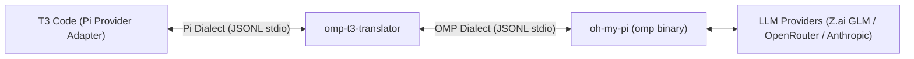

# Technical Specification: OMP-to-T3 Code Translator Shim (`omp-t3-translator`)

## 1. Executive Summary

The **OMP-to-T3 Code Translator** is an out-of-process, zero-modification stdio RPC proxy. It sits between **T3 Code**'s first-class Pi provider (`packages/provider-pi/src/server/adapter.ts`) and **Oh My Pi** (`omp` binary, v18.x+). 

### The Problem
When pointing T3 Code's Pi provider to the `omp` binary directly, turns fail or hang indefinitely:
1. **Turn Settlement Mismatch ([T3 Code #19490](https://github.com/pingdotgg/t3code/issues/19490)):** `omp` emits `session_settled` (preceded by `prompt_result`), whereas T3 Code's Pi adapter treats **only** upstream Pi's `agent_settled` frame as terminal. T3 maintainers closed #19490 as `wontfix` / "unsupported swap".
2. **Permission & Extension-UI Suppression:** T3 spawns processes strictly with `--mode rpc`. In `omp`, plain `rpc` mode silences extension UI / approval requests; dialog frames are gated behind `rpc-ui` mode. Consequently, T3's Supervised / Auto permission gates never receive tool approval prompts.
3. **Transport Frame Limit Overflow:** `omp` supports 60+ providers with hundreds of models. When T3 queries `get_available_models`, `omp`'s unpaginated response exceeds its internal 1MB frame limit (`maxFrameBytes: 1048576`), triggering `"RPC response exceeded the transport limit"` and breaking model discovery.
4. **Model Slug & ID Prefix Duplication:** T3 Code's Pi provider constructs model slugs as `${provider}/${id}`. If the model catalog returns `id` containing the provider prefix (e.g. `openrouter/deepseek/deepseek-v4.1-flash`), T3 Code constructs double-prefixed slugs (`openrouter/openrouter/...`), causing turn initiation via `set_model` to fail with `"Model not found"`.
5. **Command Discovery Query Missing:** T3 Code's provider initialization probes `get_commands`. If unhandled, initialization stalls or logs warnings.
6. **Subagent UI Incompatibility:** T3 renders subagent cards purely from Pi-convention tool-execution updates (`toolName:"subagent"`, `details.results[]`). omp names its tool `task`, attributes late child events to whichever tool is currently active, and reports children under inconsistent identities — cards go missing, split into orphans, or never terminate.
7. **Manual Compaction Silence:** omp's RPC `compact()` handler emits no compaction events at all (it awaits the whole compaction and answers once), so T3's UI shows nothing for `/compact`, and omp's benign `success:false` ("Nothing to compact (session too small)") lands on T3's turn-failure path.
8. **Auto-Compaction Cascade Noise:** omp's auto-compaction is a method cascade (`handoff`/`shake`/`context-full`) whose `skipped:true` attempts carry no `result` — forwarded raw, T3 renders each as "Context compaction failed".
9. **Command & Skill Isolation:** omp explicitly does not serve Pi's `get_commands` (its richer catalog is not wire-compatible), so the shim answered T3's polls with an empty list — T3's `/` menu exposed none of omp's 76 commands (`/context`, `/stats`, `/usage`, …) and its `$` menu none of omp's 26 skills. omp also runs builtin commands locally (`command_output` frames, completing with `data.agentInvoked:false` on the response — no `prompt_result`, no `session_settled`), a shape T3 neither renders nor settles.

### The Solution: Zero-Fork Architecture
Rather than maintaining brittle forks of T3 Code or `omp`, the **Translator Shim** acts as a lightweight proxy:
- Configured in T3 Code as the Pi provider's `binaryPath` (e.g. `/usr/local/bin/omp-t3` or `~/.local/bin/omp-t3`).
- Accepts T3's CLI arguments, rewrites `--mode rpc` to `--mode rpc-ui`, and spawns the real `omp` binary.
- Translates JSON-RPC / JSONL messages bidirectionally in real time over stdio.
- Synthesizes `agent_settled` from `session_settled`, preserves approval flows, and handles model catalog truncation safely.
- Strips redundant provider prefixes from model IDs in the catalog and defends against double-prefixed `set_model` frames from older thread states.
- Answers `get_commands` queries with a compliant empty command list.
- Persists every successful model discovery to `~/.cache/omp-t3/models.json` and serves the last-known list (flagged stale) when live discovery fails.
- Synthesizes the manual-`/compact` event pair around omp's single response, and drops `skipped:true` auto-compaction pairs entirely.
- Re-parents subagent events to the spawning `task` call so each child yields exactly one always-terminating T3 node.
- Projects omp's live command catalog onto Pi's `RpcSlashCommand[]` (skills stay `skill:`-named for T3's `$` menu), renders `command_output` inside the command-only turn, and synthesizes the `agent_settled` terminal from omp's `agentInvoked:false` completion.
- Watches for contract drift (`src/doctor.js`): records last-known-good versions, synthesizes settlement when omp withholds it, and reports drift upstream.



---

## 2. Process Lifecycle & CLI Argument Rewriting

When T3 Code starts a turn or initializes a thread, it spawns `binaryPath` with standard arguments:
```bash
<binaryPath> --mode rpc [--session <sessionId>] [--fork <sessionId>] [--hide-thinking] ...
```

### 2.1 Argument Translation Rules
| Incoming T3 Argument | Outgoing OMP Argument | Rationale |
|---|---|---|
| `--mode rpc` | `--mode rpc-ui` | **Critical:** `rpc-ui` enables tool approval frames (`extension_ui_request`) which plain `rpc` suppresses in OMP. |
| (No arguments) | `--mode rpc-ui` | Defaults to zero-flag UX if spawned standalone or without explicit flags. |
| `--session <id>` | `--session <id>` | Passthrough. OMP natively supports session resumption from disk. |
| `--fork <id>` | `--fork <id>` | Passthrough. OMP natively supports session branch/rollback. |
| `--hide-thinking` | `--hide-thinking` | Passthrough. Supported by OMP. |
| `--approval-mode <m>` | `--approval-mode <m>` | Passthrough (or mapped if T3 passes permission overrides). |
| Unknown / Bridge flags | Evaluated / Filtered | Strips any T3-specific extension flags that OMP's CLI parser would reject. |

---

## 3. Bidirectional Protocol Translation Matrix

### 3.1 Downstream (OMP $\rightarrow$ Translator $\rightarrow$ T3 Code)

| OMP Event Received | State Action | Frame Emitted to T3 Code | Notes |
|---|---|---|---|
| `{"type": "ready", ...}` | Cache protocol limits (`maxFrameBytes`) | `{"type": "ready", ...}` | Passthrough. |
| `{"type": "prompt_result", "status": s, "agentInvoked": a}` | Store `lastPromptStatus = s` | Suppressed (or converted to Pi response ack if pending) | Pi adapter does not consume OMP's `prompt_result` frame. |
| `{"type": "session_settled"}` | Read `lastPromptStatus` | `{"type": "agent_settled", "aborted": (s == "aborted")}` | **Solves #19490.** Emits terminal frame expected by T3 `PiAdapter`. |
| `{"type": "response", "command": "prompt", "data": {"agentInvoked": false}}` | Read `lastPromptStatus` | Original response unchanged, then `{"type": "agent_settled", "aborted": ...}` | Local-only slash commands (`/context`, `/stats`, …) complete via the response; no `prompt_result`/`session_settled` follows and T3's idle probe is suppressed once output rendered. |
| `{"type": "available_commands_update", "commands": [...]}` | Cache catalog (CommandBridge) | Suppressed | Pi's dialect is poll-only; the cache backs `get_commands` answers. |
| `{"type": "command_output", "text": t}` | Strip ANSI, fence | `{"type": "message_update", "assistantMessageEvent": {"type": "text_end", "contentIndex": 0, "content": fenced block}}` | T3 renders assistant text as markdown (newlines collapse); a fenced block preserves omp's monospace bar-chart layout. Swallowed when empty. |
| `{"type": "turn_start"}` | Update turn state | `{"type": "turn_start"}` | Passthrough. |
| `{"type": "turn_end", ...}` | Update turn state | `{"type": "turn_end", ...}` | Passthrough (preserves live usage metrics). |
| `{"type": "message_start", ...}` | None | `{"type": "message_start", ...}` | Passthrough. |
| `{"type": "message_update", ...}` | None | `{"type": "message_update", ...}` | Passthrough (text_delta, thinking_delta). |
| `{"type": "message_end", ...}` | None | `{"type": "message_end", ...}` | Passthrough. |
| `{"type": "extension_ui_request", ...}` | Forward dialog | `{"type": "extension_ui_request", ...}` | Delivers permission/approval modal requests to T3 UI. |
| `{"type": "advisor_cost_changed"}` | Ignored | Suppressed | OMP-internal feature; unhandled by T3. |
| `{"type": "available_commands_update"}` | None | `{"type": "available_commands_update", ...}` | Passthrough. |
| `subagent_*` frames | See synthesized `tool_execution_update` rows below | — | **Superseded:** OMP never emits `task:subagent:event`; the original rename rule was dead code and was removed. |
| `{"type": "auto_compaction_start", ...}` | Buffered (suppressed) | Held until the matching end frame | Auto-compaction is a method cascade in omp: attempts emit `reason`/`action` (`handoff`/`shake`/`context-full`) and frequently end `skipped:true`. |
| `{"type": "auto_compaction_end", ...}` | Conditional forward | `compaction_start` (held) + `compaction_end`, or nothing | Success carries `result.{summary, shortSummary?, firstKeptEntryId, tokensBefore, ...}` (verified against omp 18.11.3 binary + live frames); T3 reads `summary`/`tokensBefore`/`estimatedTokensAfter` (absent in omp — optional). **`skipped:true` pairs are dropped entirely**: no `result`, and T3 renders any result-less end as "Context compaction failed" — they are cascade noise, not failures. Aborted/failed pairs forward (stopped/failed cards). |
| Upstream `{"type": "compact", customInstructions?}` (manual `/compact`) | Compaction events synthesized | Frame forwarded untouched; downstream `{"type":"compaction_start","reason":"user_requested","action":"manual"}` | **Own solution.** omp's manual `compact()` RPC handler never emits compaction events — it awaits the whole compaction and answers with a single response. The shim synthesizes `compaction_start` on the request and `compaction_end` (result on success, `errorMessage` on failure) around omp's `command:"compact"` response, which is still forwarded so T3 can clear its in-flight flag and settle the turn. Without this, T3 shows nothing for manual compaction and a benign "Nothing to compact (session too small)" failure would fail the whole T3 turn. |
| `{"type": "subagent_lifecycle"}` / `subagent_progress` / `subagent_event` | Track per-child state by `parentToolCallId` + `id`; **re-parent to the spawning `task` call** | Synthesized `{"type":"tool_execution_update","toolCallId":<taskCallId>,"toolName":"subagent","partialResult":{"details":{"results":[…]}}}` | Opt-in via `set_subagent_subscription {level:"events"}` sent after the child `ready` frame. Entries carry `agent`,`task`,`step`,`finished`,`stopReason?`,`model?`,`messages?` (assistant text → T3 card progress/result). Raw frames suppressed (T3 ignores unknown types). **Decision: own solution** (no T3-native equivalent for OMP async children). **Parent attribution (drift fix):** omp attributes late child events (completion during a later `wait`/bash call) to the currently-active tool; trusting that split one child into several T3 nodes keyed `<parent>:subagent:<step>`, some never terminating — the shim anchors every frame to the `task` call that spawned the child, prunes state when that call ends, and re-titles children reported under the tool name `task` to their own id. |
| `{"type": "prompt_result", "sessionSettled": true}` then no `session_settled` within 15s | Contract-drift watchdog fires | Synthesized `{"type":"agent_settled", ...}` + stderr rollback notice + rate-limited GitHub issue | **Decision: own solution** — see `src/doctor.js`. Never hang a turn on drift. |

### 3.2 Upstream (T3 Code $\rightarrow$ Translator $\rightarrow$ OMP)

| T3 Command Received | Translation / Handler Action | Frame Emitted to OMP |
|---|---|---|
| `{"type": "prompt", "message": ...}` | Reset `lastPromptStatus = null`; forward prompt | `{"type": "prompt", ...}` |
| `{"type": "abort"}` | Forward abort signal to OMP | `{"type": "abort"}` |
| `{"type": "get_available_models", "id": reqId}` | **Intercepted:** Filter model catalog via `omp models --json` | Synthesized `{"id": reqId, "type": "response", "command": "get_available_models", "success": true, "data": {"models": [...]}, "models": [...]}` (avoids >1MB overflow; dual wrapper for T3 discovery) |
| `{"type": "get_commands", "id": reqId}` | **Intercepted:** Return empty command list | Synthesized `{"id": reqId, "type": "response", "command": "get_commands", "success": true, "data": {"commands": []}}` |
| `{"type": "set_model", "provider": p, "modelId": m}` | **Normalized:** Strips duplicate `${provider}/` prefix from `modelId` if present | Forwarded normalized `{"type": "set_model", "provider": p, "modelId": cleanModelId}` |
| `{"type": "set_thinking_level", "level": ...}` | Passthrough | `{"type": "set_thinking_level", ...}` |
| `{"type": "compact"}` | Passthrough | `{"type": "compact"}` |
| `{"type": "extension_ui_response", ...}` | Passthrough user approval/denial | `{"type": "extension_ui_response", ...}` |
| `{"type": "get_state"}` | Passthrough; downstream response gains `pendingMessageCount` alias (from `queuedMessageCount`) | Passthrough + enriched response | T3's settle probe finalizes only on `pendingMessageCount === 0`. |
| `{"type": "set_session_name"}` / `set_thinking_level` / `compact` / `extension_ui_response` | Passthrough | unchanged | OMP supports these natively. |
| `get_session_stats` / `get_messages` / `get_entries` / `get_last_assistant_text` | Passthrough | unchanged | OMP supports these natively (v18.11 spec). **Decision: no stub needed.** |
| Model catalog `thinking: [levels]` | Converted in prune | `reasoning: true` + `thinkingLevelMap {off..max: level|null}` | **Decision: own solution** — T3 ignores the boolean `thinking`; the map gates the Thinking option ladder. |

---

## 4. Deep-Dive: Critical Subsystems

### 4.1 Turn Settlement & Settle-Probe Harmony
In T3's `packages/provider-pi/src/server/adapter.ts`:
- When a user submits a prompt, T3 sets turn status to active.
- T3 arms an idle probe timer. If the probe fires while the agent is running, it reschedules.
- T3 only resolves the turn promise and persists output when it sees:
  ```typescript
  if (frame.type === 'agent_settled') {
    settleDeferred.resolve({ aborted: Boolean(frame.aborted) });
  }
  ```
- Because OMP only emits `session_settled`, T3 remains blocked.
- **Translator Rule:** When OMP emits `session_settled`, the translator intercepts it and transforms it into `{"type": "agent_settled", "aborted": lastPromptStatus === 'aborted'}`.

### 4.2 Safe Model Catalog Delivery & Slug Compatibility
- In OMP v18.x, querying `get_available_models` attempts to serialize hundreds of models across all providers into one JSON string. Because `maxFrameBytes` is 1,048,576 bytes, OMP aborts with `"RPC response exceeded the transport limit"`.
- **Stale-fallback chain:** every successful discovery persists the pruned catalog to `~/.cache/omp-t3/models.json`. On live-discovery failure the shim serves, in order: in-memory cache → persisted catalog → builtin minimal list (first run only). Each fallback emits a stderr notice naming the stale source, sets `stale:true` on the RPC response, and resets automatically on the next successful discovery. The doctor's discovery-failure report still fires when nothing can serve.
- In T3 Code's provider adapter (`status.ts` and `adapter.ts`):
  - Slug is built as `const slug = `${provider}/${id}`;`.
  - When starting a turn, T3 splits on the first slash: `const [provider, ...rest] = slug.split('/');`.
  - If `id` in the catalog already includes `provider/` (e.g. `openrouter/deepseek/...`), T3 creates `openrouter/openrouter/...` which fails turn initiation.
- **Translator Rule:**
  - The translator intercepts `get_available_models` requests, fetches models via `omp models --json`, and strips pricing/schemas to keep payload under 200KB.
  - Strips leading `${provider}/` from `id` so T3 builds clean single-prefixed slugs.
  - Returns both `data: { models }` and top-level `models` to satisfy both discovery mechanisms.
  - Normalizes upstream `set_model` calls so existing thread states with double-prefixed slugs still resolve cleanly.

### 4.3 Extension UI & Approval Bridging
- T3 Code's permission hook relies on bidirectional extension dialogs (`extension_ui_request` / `extension_ui_response`).
- By running OMP in `--mode rpc-ui`, OMP emits these frames for:
  - File write confirmations outside workspace.
  - Bash command approvals.
  - Interactive questions.
- The translator forwards these frames cleanly between T3's client UI and OMP's tool harness.

### 4.4 Contract Drift Watchdog (`src/doctor.js`)
- Records last-known-good `{ompVersion, shimVersion}` to `~/.local/state/omp-t3/contract-state.json` on every cleanly settled turn.
- Arms a 15s watchdog when OMP announces settlement (`prompt_result` with `agentInvoked:true && sessionSettled:true`); if `session_settled` never arrives, synthesizes it (turns never hang), prints a stderr banner naming the changed side + rollback command, and files a once-per-day GitHub issue on `hashangit/omp-t3` (via `gh`, else a prefilled URL).
- Model-discovery failure (no cache) reports through the same path.

### 4.5 Version Scheme
- `package.json` version = `<pi-major>.<pi-minor>.<pi-patch>-<iteration>` (e.g. `1.3.0-1`). The first three segments track the upstream Pi release this iteration targets; the prerelease counter is the shim's own npm publish level (npm rejects literal 4-segment versions; prerelease sorts correctly: `1.3.0-9 < 1.3.0-10 < 1.4.0-1`).
- `--version` prints the Pi base on line 1 (T3's gate parses the first semver token, requires >= 0.80.5) and the full identity on line 2. Package-derived, offline, instant.

### 4.6 Command & Skill Catalog Bridge (`src/commands.js`)
- **Discovery:** omp pushes its catalog via `available_commands_update` at startup and on metadata changes; Pi's dialect is poll-only (`get_commands`). The bridge caches every push (suppressing the raw frame — T3's adapter ignores unknown event types anyway) and serves polls from cache. A cold poll (push lost or not yet arrived) injects one single-flight `get_available_commands` (id `ompt3-cmds-<n>`) into omp and answers when it responds, with a 2.5s bounded fallback that answers empty so T3's init probe can never stall — preserving the original empty-answer guarantee for initialization.
- **Projection:** omp's richer source enum maps onto Pi's `RpcSlashCommand[]`: `skill` → `skill` (omp names are already `skill:`-prefixed, so they land in T3's `$` picker unchanged), `builtin`/`extension` → `extension` (handler-executed), `custom`/`file` → `prompt` (markdown templates); unknown sources default to `extension`. `description` is always a string; omp's `aliases`/`subcommands`/`input.hint` have no Pi counterpart and are dropped. Request ids echo with their original JSON type.
- **Local command turns:** omp executes builtins (`/context`, `/stats`, …) locally, streaming `command_output` frames and completing with `data.agentInvoked:false` on the RPC response — no `prompt_result`, no `session_settled`. The bridge re-emits each output as a `message_update`/`text_end` inside the command-only turn, ANSI-stripped and wrapped in a fenced code block (`toMarkdownBlock`, fence grows past inner backtick runs per CommonMark) because T3 renders assistant text as markdown and bare newlines would collapse omp's bar-chart layout; monospace-in-a-fence realigns it. The settlement tracker then forwards the response unchanged and synthesizes the terminal `agent_settled` — required because T3's own command-only idle probe is suppressed once a turn renders output (`sawAgentActivity`), so without synthesis the turn would stay active forever.
- **Deliberate omission:** omp's `set_auto_retry` stays off. Its retry is session-scoped and would re-run **mid-stream** failures whose partial output is already committed to the thread, duplicating content; T3's harness-level attempt retry re-runs the whole turn cleanly and is the correct recovery layer for mid-stream drops (e.g. provider `ECONNRESET`).

---

## 5. Technical Implementation Blueprint

### 5.1 Architecture & Stack
- **Language:** Node.js CLI script (`bin/omp-t3`, `src/`).
- **Dependencies:** Zero external dependencies (uses native `child_process`, `readline`, `fs`, `path`, and `os`).
- **Overhead:** < 2MB memory footprint, < 0.5ms latency per frame.

### 5.2 Configuration in T3 Code
Users configure T3 Code to use the translator via GUI Settings or `~/.t3/userdata/settings.json`:
```json
{
  "providers": {
    "pi": {
      "binaryPath": "/var/home/hash/.local/bin/omp-t3",
      "customArgs": []
    }
  }
}
```

---

## 6. Verification & Test Plan

1. **Protocol Loopback Test:**
   - Scripted driver sends `prompt`, asserts receipt of streaming `text_delta`, `prompt_result`, and final translated `agent_settled`.
2. **Cancellation / Stop Test:**
   - Send prompt, immediately send `abort`, verify `agent_settled` emits with `aborted: true`.
3. **Model Listing Test:**
   - Send `get_available_models`, verify response is `success: true`, under 500KB, with both `data.models` and `models`.
4. **Duplicate Prefix set_model Test:**
   - Send `set_model` with `openrouter/deepseek/deepseek-v4.1-flash`, verify it is rewritten to `deepseek/deepseek-v4.1-flash` and accepted by child OMP.
5. **Interactive Approval Test:**
   - Verify `extension_ui_request` arrives in T3 Code UI and user confirmation passes back via `extension_ui_response`.
6. **End-to-End T3 Run:**
   - Verified live in T3 Code UI with turns executing and settling cleanly.
7. **Subagent Card Test:**
   - Spawn a `task` subagent through the shim; verify T3 renders live subagent cards (status, model, progress text) and synthesized `tool_execution_update` frames arrive per child state change.
8. **Contract Drift Test:**
   - Feed a `prompt_result` with `sessionSettled:true` and withhold `session_settled`; verify the watchdog synthesizes `agent_settled`, prints rollback guidance, and rate-limits issue filing.
9. **Command Catalog Test (`test/commands.test.js`, `test/e2e.test.js`):**
   - Feed an `available_commands_update` push, poll `get_commands`, verify the Pi-dialect projection (skills stay `skill:`-named with `source:"skill"`), that the raw push is suppressed, and that a cold poll triggers exactly one injected `ompt3-cmds-<n>` refresh with a bounded empty-answer fallback.
10. **Local Command Turn Test:**
    - Run `/context` as a `prompt`; verify `command_output` renders as a fenced markdown block inside the turn, the `agentInvoked:false` response forwards unchanged, and exactly one synthesized `agent_settled` settles the turn.
11. **Live Binary Smoke:**
    - Drive `bin/omp-t3` against the real `omp` in an isolated profile (`-p` + `--session-dir`): 76-command catalog with 26 `skill:*` entries served, `/context` bars aligned inside the fence, single `agent_settled`.

---

## 7. Documentation Maintenance & Drift Prevention

This project's core risk is **silent protocol drift** on either side (T3 Code updates, OMP updates). Documentation is part of the contract, not commentary.

### 7.1 Living documents vs historical records
- **Living (must match the code at all times):** `README.md`, `planning_docs/omp-t3-translator-spec.md` (§3 matrix, §4 subsystems, §7 policy), `specs/001-omp-t3-translator/contracts/rpc-contract.md`, `specs/001-omp-t3-translator/contracts/cli-contract.md`, `specs/001-omp-t3-translator/data-model.md`.
- **Historical (do not silently rewrite):** `specs/001-omp-t3-translator/spec.md`, `plan.md`, `tasks.md`, `research.md`. Amended only with clearly marked `**Superseded (drift fix):**` notes — never deleted.

### 7.2 Same-PR rule
Any change that adds, removes, renames, or reshapes a translated frame MUST, in the same PR:
1. Update the §3 translation matrix (this document) and the interceptor matrices in `contracts/rpc-contract.md`.
2. Update `data-model.md` frame entities and `TranslatorState` if state changed.
3. Update `contracts/cli-contract.md` if CLI behavior or the version scheme changed.
4. Add/adjust unit or e2e tests that pin the new frame shape (a frame shape without a test is a drift regressions waiting to happen).
5. Bump the shim iteration (`<pi>-<iter+1>` in `package.json`).

### 7.3 Runtime drift reporting
- `src/doctor.js` is the enforcement arm: last-known-good bookkeeping, settle watchdog, discovery-failure reporting, rate-limited GitHub issues with rollback guidance.
- Drift signatures (`settle-missing:<ompVersion>`, `discovery-failed:<ompVersion>:<reason>`) MUST stay stable — issue de-duplication depends on them.
- When T3's adapter adds a consumed frame the shim does not translate, record it in §3 as an explicit, marked gap (`Decision: ignore/stub/own solution`) rather than leaving it undocumented.

### 7.4 Version-bump checklist
- [ ] Tests green (`npm test`)
- [ ] `omp-t3 --check` passes
- [ ] `--version` line 1 matches the targeted Pi base and satisfies T3's `MINIMUM_PI_VERSION`
- [ ] §3 matrix + contracts docs reflect any frame changes (§7.2)
- [ ] `npm publish` with the bumped iteration counter
